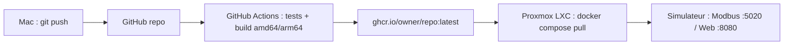

# Déploiement sur Proxmox via GitHub



## 1. Publier sur GitHub (depuis le Mac)

1. Créer un dépôt vide sur https://github.com/new (ex. `simul-ws`, sans README).
2. Pousser le code :
   ```bash
   cd /Volumes/home/Github/Simul-WS
   git remote add origin https://github.com/<owner>/simul-ws.git
   git push -u origin main
   ```
3. Onglet **Actions** : le workflow *Docker image* lance les tests puis publie
   `ghcr.io/<owner>/simul-ws:latest` (~3-5 min la première fois).
4. **Rendre l'image publique** (sinon il faudra un token sur Proxmox) :
   profil GitHub → *Packages* → `simul-ws` → *Package settings* → *Change visibility* → **Public**.

Versionner une release : `git tag v1.0.0 && git push --tags` → tags `1.0.0`, `1.0`, `latest`.

## 2. Préparer le conteneur Docker sur Proxmox

### Option A (recommandée) : script « Docker LXC » des Proxmox Helper Scripts

Les scripts de **tteck** sont désormais archivés et maintenus par la communauté sur
https://community-scripts.github.io/ProxmoxVE/ (le lien `tteck.github.io` peut ne plus fonctionner).
Dans le **shell de l'hôte Proxmox** (pas dans un CT) :

```bash
bash -c "$(curl -fsSL https://raw.githubusercontent.com/community-scripts/ProxmoxVE/main/ct/docker.sh)"
```

- Choisir **Advanced** pour fixer une **IP statique** (ex. `192.168.1.50/24` + passerelle) :
  c'est l'IP que verront vos clients Modbus, et elle est écrite dans `.env` à l'installation.
  (Alternative : garder DHCP + réservation DHCP sur votre routeur.)
- Les ressources par défaut (Debian, non privilégié, `nesting` activé) conviennent largement.
- Portainer / Docker Compose : répondre selon vos préférences ; le *plugin* `docker compose`
  est requis par notre script (il est installé par défaut avec Docker Engine).

Une fois le CT créé : `pct enter <CTID>` (ou console Proxmox) puis étape 3.

### Option B : création manuelle

1. *Create CT* → template `debian-12-standard`, 1 vCPU, 512 Mo RAM, 4 Go disque, IP fixe.
2. *Options → Features* : cocher **nesting** et **keyctl** (indispensables pour Docker en LXC) :
   ```bash
   pct set <CTID> --features nesting=1,keyctl=1
   pct start <CTID>
   ```
   Notre `install.sh` installera Docker automatiquement.

> Une **VM** Debian/Ubuntu fonctionne aussi, sans réglage particulier.

## 3. Installer le simulateur (dans le LXC, en root)

```bash
apt update && apt install -y curl
curl -fsSL https://raw.githubusercontent.com/<owner>/simul-ws/main/deploy/install.sh \
  | bash -s -- --repo <owner>/simul-ws --auto-update
```

Le script : installe Docker si absent, crée `/opt/waveshare-relay/` (compose + `.env`
avec l'IP du LXC détectée), récupère l'image depuis GHCR et la démarre.
`--auto-update` ajoute un cron quotidien (04:15) qui récupère la dernière image publiée.

**Dépôt/paquet privé** : avant la commande, `export GITHUB_TOKEN=ghp_xxx GITHUB_USER=<login>`
(PAT classique, scopes `repo` + `read:packages`).

### Alternative manuelle / Portainer
Copier [`deploy/docker-compose.yml`](deploy/docker-compose.yml) et `deploy/.env.example` → `.env`
dans un dossier (ou une *Stack* Portainer), adapter `WAVESHARE_IMAGE` et `WAVESHARE_IP`, puis
`docker compose up -d`.

## 4. Vérifier

- Interface web : `http://192.168.1.50:8080/`
- Modbus : client sur `192.168.1.50:5020`
- Logs : `cd /opt/waveshare-relay && docker compose logs -f`
- Santé : `docker ps` → `(healthy)`

## 5. Mettre à jour

Sur le Mac : `git push` → GitHub Actions republie `latest`.
Sur Proxmox : automatique avec `--auto-update`, sinon :
```bash
cd /opt/waveshare-relay && docker compose pull && docker compose up -d
```

## Réglages utiles (`/opt/waveshare-relay/.env`)

| Variable | Exemple | Note |
|---|---|---|
| `HOST_MODBUS_PORT` | `502` | Port Modbus standard (annoncé aussi en FC04) |
| `HOST_WEB_PORT` | `8080` | Port de l'UI |
| `WAVESHARE_IP` | `192.168.1.50` | IP du LXC (auto au 1er install) |
| `WAVESHARE_DEVICE_ADDRESS` | `1` | Adresse esclave |

Après modification : `docker compose up -d`.

## Dépannage

| Symptôme | Cause / solution |
|---|---|
| `docker: permission denied` / `operation not permitted` dans le LXC | Activer `nesting=1,keyctl=1` puis redémarrer le CT |
| `denied` / `unauthorized` au `pull` | Paquet GHCR privé → le rendre public ou définir `GITHUB_TOKEN` |
| `manifest unknown` | Le workflow n'a pas (encore) publié : vérifier l'onglet Actions |
| UI inaccessible depuis le LAN | Pare-feu Proxmox (Datacenter/CT → Firewall) : autoriser TCP 5020 et 8080 |
